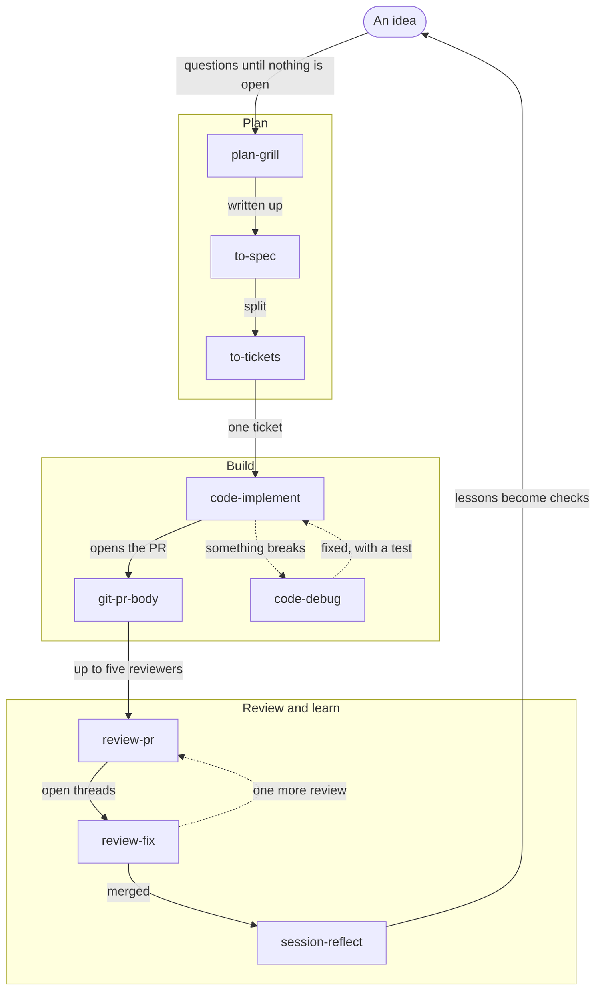

# h2xd skills

55 skills and 12 agents for Claude Code. They keep what an agent learns in the
repo, where the next session finds it. They build on many great skill repos and
grew out of my own projects.

Those projects keep their knowledge in an
[Open Knowledge Format](https://github.com/GoogleCloudPlatform/open-knowledge-format/blob/main/SPEC.md)
bundle that works as an [LLM wiki](https://gist.github.com/karpathy/442a6bf555914893e9891c11519de94f).
I hope the skills help you too. Take what helps, leave the rest, and
[open an issue](https://github.com/h2xd/skills/issues) for what is missing.

The idea is simple. An agent forgets everything the moment a session ends, but
a repo does not have to. The skills keep the knowledge where the next session
finds it: in docs that stay true, decisions with a paper trail, commits that
explain themselves, and reviews that hold the bar.

An agent forgets a rule, but a lint does not. That is why this set lints so
much: the docs, the glossary words, the commit messages, the PR bodies, and the
language of the skills themselves. Where a rule can be a check, it is one, and
it runs without an agent, in git hooks and in CI.

## News

**0.6.0 adds a design group and a committee.** See the
[releases](https://github.com/h2xd/skills/releases) for every change.

- **The design system lives in the repo.**
  [`design-setup`](skills/design-setup/SKILL.md) builds one inventory of
  reusable elements and an overview page. It also writes an agent view that
  agents read with `curl` or from git.
- **Each small design choice gets a log entry.**
  [`design-log`](skills/design-log/SKILL.md) writes it, and later answers why
  an element looks the way it does.
- **Drift gets found.** [`design-tidy`](skills/design-tidy/SKILL.md) audits
  the inventory against the code, fixes the safe findings and asks about the
  rest.
- **Claude Design gets a mirror.** [`design-mirror`](skills/design-mirror/SKILL.md)
  exports the design pages, and your own sync skill pushes them. The repo
  stays the only author.
- **A committee judges UI variants.**
  [`design-variants`](skills/design-variants/SKILL.md) lets three agents build
  one screen, a tester walks each, and the committee picks one.
- **The committee also judges plans and diffs.**
  [`ask-committee`](skills/ask-committee/SKILL.md) convenes a design chapter
  and an engineering chapter. Leads call members and workers through call
  files, and the chair routes each call. The UX designer and the architect
  can block. When the chapters disagree, you decide.
  [`members.md`](skills/ask-committee/members.md) shows the hierarchy, and
  [ADR 0002](docs/decisions/0002-ask-committee-hierarchy.md) records the
  committee shape.

## Install

One line in your terminal:

```sh
claude plugin marketplace add h2xd/skills && claude plugin install h2xd@h2xd
```

Then open a repo and run `/h2xd:setup`. It asks where issues and docs live,
which commit rules and writing tone you want, and then sets up the repo.

To update later, run `claude plugin update h2xd@h2xd`.

## What setup does

`/h2xd:setup` reads the repo first, then asks only what it cannot see. The
questions come in rounds of at most four. Each has a recommended answer that
you accept with one click.

It asks about:

- the issue tracker: GitHub, GitLab or local markdown files
- the docs bundle: where it lives, and whether to adopt or migrate an existing one
- the project and technical glossaries, and the fields each entry needs
- the language of each kind of page
- the commit types and scopes, and how long a message may be
- whether a new decision record needs an issue
- the hooks and CI workflows that enforce the rules
- the commands a fresh worktree runs before it can typecheck
- mutation testing, and which runner plants the bugs
- the size limits that decide how many reviewers a PR review starts, and the paths that always get all of them
- how many build workers may build one ticket at the same time
- a hook that stops the agent from running destructive git commands
- the triage labels
- module boundaries, for TypeScript repos
- the writing tone of the agent

Then it shows every draft and writes nothing until you agree. It writes
`agents.config.json`, copies the scripts, git hooks and CI workflows, and adds
the `package.json` scripts. It also seeds `docs/`, creates the issue labels and
adds its blocks to `CLAUDE.md` or `AGENTS.md`.

It ends with one status line per item. 🟢 means written, 🟡 means a follow-up,
and 🔴 means something blocks a skill. Run it again to update the scripts or to
change an answer.

## The loop



Not sure where you are in it? `/h2xd:next` knows.

## What keeps it honest

| Promise | Kept by | Checked by |
|---|---|---|
| **Docs stay true.** `docs/` is an [LLM wiki](https://gist.github.com/karpathy/442a6bf555914893e9891c11519de94f) in [Open Knowledge Format](https://github.com/GoogleCloudPlatform/open-knowledge-format/blob/main/SPEC.md), with a project glossary and a technical glossary. | `docs-wiki`, `docs-glossary` | The docs lint, in `pre-commit` and CI |
| **Decisions do not overlap.** Every decision record starts as an issue, after a search for records on the same question. | `docs-adr` | The docs lint fails a record without its issue. The PR lint fails a body without `Closes #<n>`. |
| **History explains itself.** Closed types and scopes, a short body, the reasoning in the footer. | `git-commit`, `git-pr-body` | The `commit-msg` hook and CI |
| **Reviews hold the bar.** Up to five reviewers per PR review, picked from the diff: correctness, standards, comments, mutation testing and blast radius. | `review-pr`, `review-fix` | The `review` script runs every mechanical step |

## Skills

Skills are sorted into groups, and most names start with their group. Click a
group to open it. The **Starts** column says who can start a skill:

- *auto*: the model picks it when it fits, and you can call it too.
- *you*: only you start it, because it posts in public, costs a lot, or is a
  deliberate step.

### Core

Set up once, then let `next` show the way. The two `add-` skills keep every
skill and every sentence clean.

<details>
<summary><b>Core</b>: setup, next, writing skills and prose</summary>

| Skill | What it does | Use when | Starts |
|---|---|---|---|
| `setup` | Asks a few questions, then writes the config, scripts, hooks, CI and seed docs | Once per repo, and again to update or change a choice | you |
| `setup-tone` | Sets the writing tone, such as ASD-STE100, as the repo's default style | You want short, plain, summary-first agent text | you |
| `setup-wizard` | Writes a shell script that walks a person through steps only they can do | A task needs someone at a browser, such as setting secrets | you |
| `next` | Reads your branch, changes and PR, and names the one next step | You don't know what comes next | auto |
| `add-skill` | Writes skills and agent prompts an agent follows without guessing | You create or edit a skill, an agent or an instructions file | auto |
| `add-soul` | Cuts AI tells and walls of text from prose | Prose should read as a careful person wrote it | you |

</details>

### Docs

The memory of the repo. Pages that change with the code, one word per thing,
and every decision with its reason.

<details>
<summary><b>Docs</b>: wiki, glossary, decisions, research, fact check, proofread, quiz</summary>

| Skill | What it does | Use when | Starts |
|---|---|---|---|
| `docs-wiki` | Ingests, queries and lints the docs, and keeps pages in step with the code | A page changes, code a page describes changes, or a source arrives | auto |
| `docs-glossary` | Adds, sharpens and renames terms in the two glossaries | A new term comes up, or two words name one thing | auto |
| `docs-adr` | Checks for overlap, opens the issue, writes the decision record, links the PR | A hard-to-reverse decision is made or contradicted | auto |
| `docs-research` | Answers a question from primary sources and files it in the docs | You need facts about a library, an API or a standard | auto |
| `docs-fact-check` | Checks each claim of an idea against the pages, glossaries and decisions | An idea or plan may disagree with what the wiki says | auto |
| `docs-proofread` | Proofreads the wiki with several agents, fixes words and links, and suggests the rest | Overnight, or before a release, to keep the pages one piece | you |
| `docs-quiz` | Lets a fresh agent answer real questions from the wiki alone, and grades the answers | You want to know whether the wiki helps a newcomer | you |

</details>

### Plan

Before a line of code. Turn a fuzzy idea into decisions, a spec and tickets
that another agent can pick up next week.

<details>
<summary><b>Plan</b>: grill, sharpen, prototype, triage, and turn talk into artifacts</summary>

| Skill | What it does | Use when | Starts |
|---|---|---|---|
| `plan-grill` | Asks up to four clickable questions at a time until no decision is open | A plan still has open choices, such as "grill me on the CSV export idea" | auto |
| `plan-sharpen` | Makes a task deeper, not bigger, and rewrites the prompt | A task feels shallow or the prompt is vague | auto |
| `plan-prototype` | Builds throwaway code to answer one design question | You want to try a state model, flow or UI first | you |
| `plan-triage` | Moves issues through triage and writes agent-ready briefs | The tracker needs sorting | you |
| `to-spec` | Turns the conversation into a spec issue | A discussed feature should be written down | auto |
| `to-tickets` | Splits a spec into tickets with blockers and acceptance criteria | The spec is settled | you |
| `to-page` | Renders a checklist, a round of decisions or one decision in depth as a page, and reads the answers back as JSON | Many checks or decisions wait on you or the team | auto |
| `to-questionnaire` | Turns what a customer must answer into a questionnaire page, and reads the answers back | A plan waits on a customer or another person outside the team | you |

</details>

### Ask

Three question words, a teacher and a committee. Ask them as often as you
like.

<details>
<summary><b>Ask</b>: what, how, why, teach, committee</summary>

| Skill | What it does | Use when | Starts |
|---|---|---|---|
| `what` | Says the last message again, in plain words | The last answer did not land | auto |
| `how` | Explains how code works and where new code belongs | You want the map before you change something | you |
| `why` | Explains why code is the way it is, with sources | You want the reason behind a choice or a number | you |
| `teach` | Explains a whole body of work plainly, built on `how` and `why` | You want to understand a whole part of the system | you |
| `ask-committee` | A design chapter and an engineering chapter of reviewer agents vote. Each lead merges its chapter's votes, and the chair writes one verdict with every vote attached | You want a verdict on variants, a design, a plan or a diff | you |

</details>

### Code

Where the work happens. The rules for how an agent works, the bar for how code
looks, and the loops that turn a ticket into a passing change.

<details>
<summary><b>Code</b>: rules, quality, implement, TDD, debug, architecture, arena, swarm, TypeScript</summary>

| Skill | What it does | Use when | Starts |
|---|---|---|---|
| `code-rules` | How an agent works: asking, context, scripts, order of work, failed fixes | Any task bigger than a one-line edit | auto |
| `code-quality` | The quality and architecture bar, and the smells reviewers check | You write or review code that more than one function calls | auto |
| `code-implement` | Works one ticket from branch to a reviewed PR with parallel build workers, asking only for test entry points and unsure files | You pick a ticket to build | auto |
| `code-tdd` | Test-first when the change is clear, ending with a mutation check | You want test-first work or a regression test | auto |
| `code-debug` | Builds a command that goes red on the bug, then fixes the root cause | Something is broken and the cause is unknown | auto |
| `code-architecture` | Finds shallow modules and other weak spots, ranked | You want refactoring targets | you |
| `code-arena` | Runs several attempts at one change and grafts the best parts | A change deserves competing versions | you |
| `code-swarm` | Fans a task out to parallel workers and returns one report | A task splits into many independent slices | you |
| `lang-ts-base` | Type patterns that make the compiler reject bad states | You read or edit `.ts` and `.tsx` files | auto |
| `lang-ts-deep-modules` | Build rules so modules are imported only through their entry points | A TypeScript repo should enforce module seams | you |

</details>

### Prove

Tests pass. But would they catch a real bug? This group checks tests, risky
changes, numbers and the running app against the real thing.

<details>
<summary><b>Prove</b>: mutation tests, blast radius, measurements, end-to-end checks</summary>

| Skill | What it does | Use when | Starts |
|---|---|---|---|
| `prove-tests` | Plants plausible bugs and reports the ones no test catches | After writing tests, or before review | auto |
| `prove-blast-radius` | Finds what a change breaks outside the diff, by running real code | A change touches shared code | auto |
| `prove-measure` | Vets a number and finds what limits it | Before you trust a benchmark or a score | auto |
| `prove-e2e-create` | Generates a repo skill that drives the app like a user | The repo has no scripted end-to-end check | you |
| `prove-e2e-maintain` | Keeps that skill honest as the app changes | The app changed since the last check | you |

</details>

### Git

History is the one record every future session reads. Make it worth reading.

<details>
<summary><b>Git</b>: commits, PR bodies, guardrails</summary>

| Skill | What it does | Use when | Starts |
|---|---|---|---|
| `git-commit` | Writes a commit message the hook accepts and the next session can use | Before every commit | auto |
| `git-pr-body` | Writes a PR body: closing line, summary, evidence, merge danger. Then pushes and opens the PR | You open a PR | auto |
| `git-guardrails` | Installs a hook that stops agents from destructive git commands | You want no surprise pushes or resets | you |

</details>

### Review

Five reviewers and one grim reaper.

<details>
<summary><b>Review</b>: review a PR, fix the threads, clean comments, check the skills</summary>

| Skill | What it does | Use when | Starts |
|---|---|---|---|
| `review-pr` | Picks up to five reviewers from the diff, then posts one review without asking | A PR is ready | auto |
| `review-fix` | Fixes the review threads, pushes, replies and resolves them. Asks only when a check fails | A PR has comments to address | auto |
| `review-code-comments` | Sends the comment reaper over a diff | Before review, or when the comments in a diff only repeat the code | auto |
| `review-skills` | Finds skills that overlap and proposes exact fixes | The wrong skill fires, or after adding several | you |

</details>

### Design

One inventory of every reusable element, kept tidy and mirrored to Claude
Design. Agents build variants, and `ask-committee` judges them.

<details>
<summary><b>Design</b>: setup, log, tidy, mirror, variants</summary>

| Skill | What it does | Use when | Starts |
|---|---|---|---|
| `design-setup` | Builds the inventory, the overview page, the agent view for curl, the design log and the design config page | A repo has no design system, or a hand-written one | auto |
| `design-log` | Writes one dated entry per small design decision, links it from the inventory, and answers why an element looks that way | A design choice is made, or you ask why | auto |
| `design-tidy` | Finds missing, dead and copied elements, literal values and stale intent entries. Fixes the safe ones and asks about the rest | Every few weeks, or after a burst of UI work | auto |
| `design-mirror` | Exports the design pages as snapshots, diffs them against the last push, and writes the hand-off the user's sync skill pushes from. The repo stays the only author | The inventory, a token or a page changed | you |
| `design-variants` | Three UI prototyper agents build one task as real pages, a usability tester agent reviews each, they revise once, and the committee picks one. It ends with a ticket | A screen or element has no obvious shape | you |

</details>

### Session

The end of one session is the start of the next.

<details>
<summary><b>Session</b>: handoff and reflect</summary>

| Skill | What it does | Use when | Starts |
|---|---|---|---|
| `session-handoff` | Writes a handoff document the next agent picks up | Context runs low, or someone else takes over | auto |
| `session-reflect` | Turns each lesson into a check, a type, a lint, a test or, last, words | After a session, or when a mistake repeats | auto |

</details>

## Agents

- **`comment-reaper`** hates comments. It deletes every one its keep list does
  not protect, and marks the code that needed one. Its first words on every
  run: "Every comment's hour comes."
- **`skill-polisher`** reads one skill in a new context, on a fast model. It
  fixes errors and walls of text, and suggests better names. `add-skill` sends
  one per skill.
- **The committee** is ten `committee-*` agents in a design chapter and an
  engineering chapter. `ask-committee` runs them, and `design-variants`
  starts the UI prototyper and the usability tester.
  [`skills/ask-committee/members.md`](skills/ask-committee/members.md) is the
  one place for their tiers and calls. The two directors use the `fable`
  model alias. When the CLI does not know it, `ask-committee` starts them
  again with a model override.

## Layout

```
.claude-plugin/   plugin and marketplace manifests
skills/           one folder per skill
agents/           comment-reaper, skill-polisher, committee-*
templates/        what setup copies into a repo
  scripts/        docs lint, find and resolve, commit and PR lint, review and implement helpers, mutation runner
  githooks/       pre-commit, commit-msg
  hooks/          the agent hook git-guardrails installs
  workflows/      docs.yml, pr.yml
  output-styles/  tone templates, such as asd-ste100.md
  docs/           seed bundle: index, log, both glossaries
  agents.config.json
scripts/          the skills lint and this repo's tests
.claude/          this repo's tone, ASD-STE100, and links to skills/ and agents/
.github/          this repo's CI
```

<details>
<summary><b>Developing</b></summary>

Pull requests are welcome. For a bigger change, please open an issue first so we
can talk it through.

The scripts need Node 22.18 or later and no npm packages. Development uses
Node 26, pinned in `.prototools` and `.nvmrc`. [proto](https://moonrepo.dev/proto)
installs the pinned version:

```sh
bash <(curl -fsSL https://moonrepo.dev/install/proto.sh)
proto install
```

With nvm, run `nvm install` instead. Then:

```sh
npm ci
npm run typecheck
npm test
```

`npm test` also runs the skills lint on every skill. CI runs the same on Node
22.18 and 26, plus a shell syntax check and a lint of a fresh seed bundle.
Without a local Node:

```sh
docker run --rm -v "$PWD":/src:ro node:26 sh -c \
  'cp -r /src /w && cd /w && npm ci && npm run typecheck && npm test'
```

A new skill follows [`skills/add-skill/SKILL.md`](skills/add-skill/SKILL.md)
and gets a row in [`skills/next/catalog.md`](skills/next/catalog.md). Bump
`version` in `.claude-plugin/plugin.json` for every release, because Claude Code
updates installed plugins by version.

</details>

## License

MIT, see [`LICENSE`](LICENSE). The licenses and notices of the work this set
builds on are in [`THIRD_PARTY_NOTICES.md`](THIRD_PARTY_NOTICES.md).

This set stands on the shoulders of two generous people. Much of it is their
work, reshaped to fit my own workflow:

- **Matt Pocock** and [mattpocock/skills](https://github.com/mattpocock/skills). The
  grilling interview, the spec and ticket flow, the triage roles, the TDD
  seams and much more began there.
- **Lauren Tan** and [pstack](https://github.com/cursor/plugins/tree/main/pstack).
  The rules behind `add-soul`, the comment reaper, the blast radius, the arena
  and many of the working principles began there.

Thanks also to **Dex Horthy** at [HumanLayer](https://github.com/humanlayer/skills).
The HumanLayer show-me skill gave `git-pr-body` its summary views. Thanks too to
the author of an [ASD-STE100 output style gist](https://gist.github.com/starise/470f53dbd16149dcd168fa45bff17d1f)
that inspired this repo's tone.

Thank you all for sharing such fantastic work in the open. Where these skills
are good, a lot of that is yours. Where they fall short, the fault is mine.
