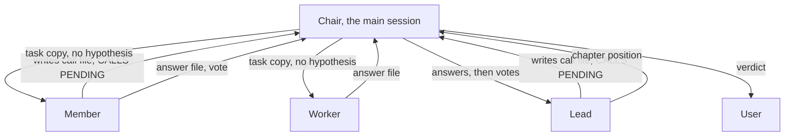

# Shape the ask-committee hierarchy as two chapters in three tiers, with calls routed by the chair

## Context and Problem Statement

[`h2xd:ask-committee`](../../skills/ask-committee/SKILL.md) puts variants, a
design, a plan or a diff before reviewer agents. The skill needs a structure:
which agents exist, who reports to whom, who can ask whom for work, and who
can stop a decision.

In Claude Code, a subagent cannot start another subagent. So a lead cannot
start a worker to test a hypothesis. How do upper agents get work from lower
agents, and where does the structure live?

## Decision Drivers

* A subagent cannot start a subagent. Only the main session can start or
  resume an agent.
* A lead must test a hypothesis with evidence, such as a page, a proof or a
  number, before it writes a position.
* The user wants a lead to ask its members for feedback, not only its workers.
* A new member or worker must not make the work of the
  [Chair](/glossary/project.md#chair) grow.
* A minority view and a block must reach the user unchanged.
* Each run has a known cost in agents.

## Considered Options

* Two chapters in three tiers, with calls routed by the chair through call files
* Nested subagents: a lead starts its members and workers itself
* A flat committee with no hierarchy
* Leads call workers only
* A settle round between the leads after the positions
* The hierarchy stored in each agent file

## Decision Outcome

Chosen option: "Two chapters in three tiers, with calls routed by the chair
through call files", because it is the only option that works without nested
subagents and still lets a lead test a hypothesis down its
[Chapter](/glossary/project.md#chapter).

The shape:

| Area | Decision | Where |
|---|---|---|
| Chapters | Two: design and engineering. The chair convenes only the chapters the question touches | [`members.md`](../../skills/ask-committee/members.md) |
| Tiers | Lead (the director), member, worker. A lead merges votes into a position. A member judges in one lens. A worker builds or checks one thing | [`members.md`](../../skills/ask-committee/members.md), [`lead.md`](../../skills/ask-committee/lead.md), [`member.md`](../../skills/ask-committee/member.md), [`worker.md`](../../skills/ask-committee/worker.md) |
| Names | `committee-<chapter>-<function>`, such as `committee-design-ux-designer` | [`agents/`](../../agents/) |
| Source of the hierarchy | `members.md` is the only source of who calls whom and who can block | [`members.md`](../../skills/ask-committee/members.md) |
| Calls | An agent writes a [Call file](/glossary/technical.md#call-file), `calls/<short name>-<n>.md`, and ends its turn with `CALLS PENDING: <count>` | [`calls.md`](../../skills/ask-committee/calls.md) |
| Routing | The chair writes a [Task copy](/glossary/technical.md#task-copy) without the caller's hypothesis, starts or resumes the callee, and resumes the caller when every call has an answer or a refusal | [`calls.md`](../../skills/ask-committee/calls.md) |
| Budgets | A lead makes at most 4 calls, a member at most 2. The chair runs its loop at most 3 times | [`calls.md`](../../skills/ask-committee/calls.md) |
| Modes | `quick` is the default: members vote, then leads write a position. `full` adds calls and a hypothesis turn for each lead | [`question.md`](../../skills/ask-committee/question.md) |
| Splits | No settle step. When the positions pick different options, the verdict leaves the choice to the user | [`vote.md`](../../skills/ask-committee/vote.md) |
| Blocks | The UX designer and the architect can block. A lead copies a block unchanged. A block check quotes the change text that lifts it | [`members.md`](../../skills/ask-committee/members.md), [`vote.md`](../../skills/ask-committee/vote.md) |

All files of a run live in the
[Committee folder](/glossary/technical.md#committee-folder), `$WORK/committee/`.

### Consequences

* Good, because a lead tests its hypothesis with real evidence from a worker
  or a member, although no subagent starts another.
* Good, because a callee never sees the caller's guess, so its answer is not
  biased toward it.
* Good, because a new member or worker is one row in `members.md`. The chair
  still reads two positions, not every vote.
* Good, because a run has a known base count and a ceiling: 6 agents in
  `quick` mode with both chapters, at most 22 in `full` mode.
* Good, because a split or a block goes to the user with every vote attached.
* Bad, because every call costs a full turn of the chair: collect, write the
  task copy, start the callee, resume the caller.
* Bad, because a member that answers a call must be resumed, and the
  resumed agent keeps the context of its vote.
* Bad, because a split verdict gives the user a choice to make. The committee
  does not settle it.

### Confirmation

* `members.md` has a "Can call" and a "Can block" column for each agent.
  No agent file under `agents/committee-*.md` lists whom it can call. Each
  one points to its row in `members.md`. An agent file that can block gives
  only the reason for its block.
* `calls.md` holds the only call budget, loop budget and agent counts. Other
  files point to its Cost section.
* `node scripts/lint-skills.ts` passes on `skills/ask-committee/` and on each
  `agents/committee-*.md` file.

## Pros and Cons of the Options

### Nested subagents

* Good, because a lead would start its own workers, with no chair loop.
* Bad, because Claude Code does not let a subagent start a subagent. This
  option cannot run.

### A flat committee with no hierarchy

* Good, because every agent votes once, and the chair merges all votes.
* Bad, because the chair reads every vote, so its work grows with each new
  agent.
* Bad, because no lead can test a hypothesis before it judges.

### Leads call workers only

* Good, because a member votes once and is never resumed for a call.
* Bad, because a lead cannot ask a member for feedback, and the user wants
  that.

### A settle round between the leads

* Good, because the committee could give one option when the chapters split.
* Bad, because it adds a round of turns for each lead.
* Bad, because it does not give a better verdict. The user still weighs the
  same trade-off, now with less of the disagreement visible.

### The hierarchy stored in each agent file

* Good, because each agent reads its own calls and its block right in its
  file.
* Bad, because the hierarchy is spread over ten files, and two files can
  disagree. `members.md` keeps it in one place.

## Diagram

## More Information

* The agents are in [`agents/`](../../agents/), one file per
  `committee-<chapter>-<function>`.
* [`h2xd:design-variants`](../../skills/design-variants/SKILL.md) starts the
  UI prototyper and the usability tester outside a committee run, then runs a
  `quick` committee.
* No tracker issue: records in this repo need none, per
  [`agents.config.json`](../../agents.config.json).
