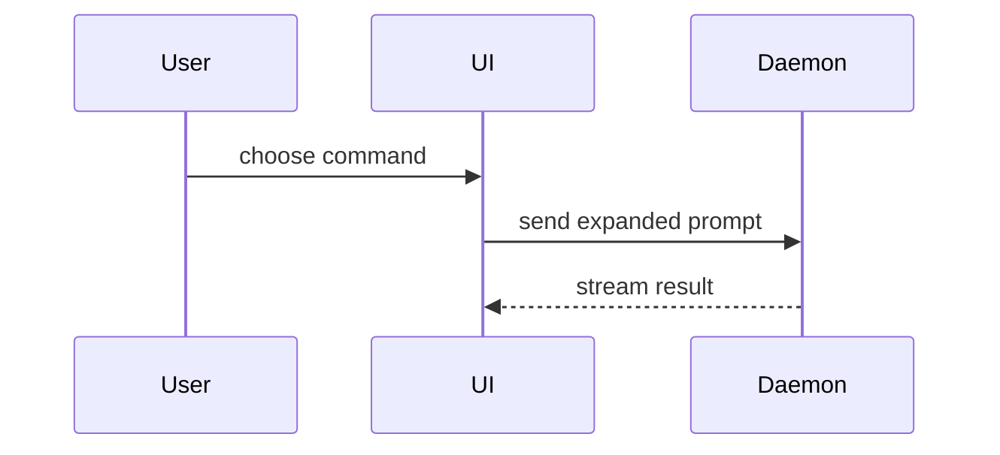

# Summary visuals

The examples below come from Dex Horthy's show-me skill at HumanLayer, by way of
Matt Pocock's `pr` skill. Both are MIT. See `THIRD_PARTY_NOTICES.md`.

A reviewer sees a 12-line call tree in five seconds. The same change as a
400-line diff costs them ten minutes. Pick the smallest view that makes the
point.

- Place each view next to the sentence it supports.
- Keep only the calls, files, props, states and boundaries the reviewer needs
  to check this change.
- One view is usual. Three is the most. Every kind at once is never right.

## Pseudocode, for logic or an algorithm

```text
on(save)
  if content is unchanged
    return cached result
  write new content
  return fresh result
```

## Call tree, for runtime control flow

```text
submitForm
  createSession
    persistPrompt
    launchAgent
  navigateToSession
```

## Component tree, for UI structure

Include the state and module boundaries that matter.

```text
<SessionPage> (apps/example/src/routes/session.tsx)
  useSessionEvents()
  <SessionToolbar>
    <RunSkillButton> (packages/ui)
```

## File tree, for file ownership or a broad refactor

Keep it shallow.

```text
src/
├── commands/       # parses user actions
├── sessions/       # owns session state
└── transport/      # sends API requests
```

## Mermaid, for interaction, control flow or data flow

GitHub renders a `mermaid` block as a diagram.



## Diff, for what changes in a shape that already exists

Match the diff to the view it changes.

A component change:

```diff
 <SessionPage>
   useSessionEvents()
   <SessionToolbar>
+    <RunSkillButton />
   <SessionTimeline>
+    <SkillResultCard />
```

A file layout change:

```diff
 src/
 ├── commands/
+│   └── show-me.ts       # expands the slash command
 ├── sessions/
-└── transport.ts
+└── transport/
+    ├── client.ts
+    └── stream.ts
```

A call tree change:

```diff
 submitForm
   createSession
     persistPrompt
+    expandSkillMention
     launchAgent
   navigateToSession
+    subscribeToEvents
```

A state or control flow change:

```diff
 on(save)
-  write content
+  if content is unchanged
+    return cached result
+  write new content
+  invalidate cache
```

## Whole block, for new code

Show the whole block when most of it is new, when a cut would hide ownership
or order, or when the reviewer needs the exact target shape.

```ts
function expandSkill(command: string): string {
  const skillName = command.slice(1);
  return `use the ${skillName} skill`;
}
```
